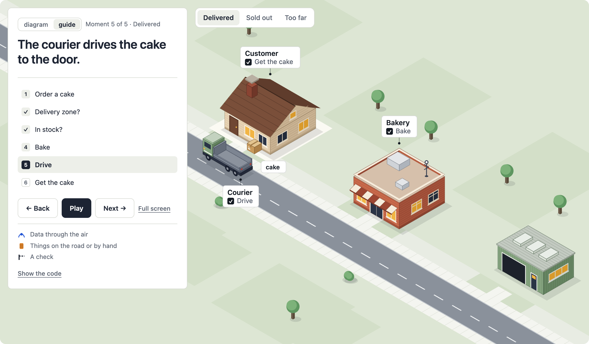

<div align="center">

<h1></h1>

### See how your code works, one step at a time.

AI writes code faster than you can read it. Your coding agent reads the code and writes a short JSON spec of one flow.
flowfig checks the spec and draws it as an animated figure that you can understand in a minute.

<p>
  <a href="https://www.npmjs.com/package/flowfig"></a>
  <a href="https://github.com/iamalvisng/flowfig/actions/workflows/ci.yml"></a>
  <a href="LICENSE"></a>
</p>

Try it: run <code>npx flowfig init</code> in your repo, then ask your agent to <i>draw how checkout works</i>.

<sub>A made-up cake shop app in 3 stories. In your repo, each box can link to the function that does the step.</sub>


</div>

The same spec also makes a guide for a reader who does not know the code. The guide tells one moment at a time:



## Why flowfig

- **Your agent draws it from the code.** `npx flowfig init` teaches your coding agent to write the spec. You ask in
  plain words. It works with Claude Code, Cursor, GitHub Copilot, Gemini CLI, Windsurf, Kiro, and Codex and other
  agents that read `AGENTS.md`.
- **flowfig checks it.** `flowfig check` finds ids that point nowhere, text wider than its box, edges through boxes,
  overlapping labels and low contrast. The agent reads the faults and fixes the spec. `flowfig verify` fails CI when a
  linked function is gone.
- **It plays where you read code.** The figure is one SVG file with no script. It plays in a README, a pull request or
  an issue.
- **One spec, many forms.** The same spec draws a map, a list of the messages in order, swimlanes, a timeline, the parts inside a box, or
  a guide for a person.

## Quick start

1. Set up your repo:

   ```bash
   npx flowfig init
   ```

2. Start a new agent session and ask in plain words:

   ```
   draw how checkout works in this repo
   ```

   In Claude Code, you can also run `/figure how does checkout work`.

3. The agent writes an SVG and ends its reply with `npx flowfig open <path>`. Run that command to see the figure in your
   browser.

To use the React player or the Node API, install the package: `npm i flowfig`. flowfig needs Node 18 or later. Only the
React player needs React (18 or later).

## Forms

<table>
  <tr>
    <td width="50%"><br/><b>Map and rail.</b> One row for each message, with its payload.</td>
    <td width="50%"><br/><b>Swimlanes.</b> One lane for each role, steps in time order.</td>
  </tr>
  <tr>
    <td><br/><b>Timeline.</b> One track for each team, with dated bars and milestones.</td>
    <td><br/><b>States.</b> A lifecycle with a start state and end states.</td>
  </tr>
</table>

The figure at the top is the map form. A box can also open to show the parts inside it, down to 3 levels. Each form
is one field in the spec. See [the spec](docs/spec.md#forms).

## Fail CI when a figure no longer matches the code

A box, an edge or a message can name the code that it draws:

```json
{ "id": "verify", "label": "verifyPassword", "source": "src/auth/login.ts#verifyPassword" }
```

If someone renames `verifyPassword`, `verify` fails with exit code 1:

```console
$ npx flowfig verify login.svg
error    missing-symbol     login.svg: box "verify" -> src/auth/login.ts#verifyPassword: symbol not defined
1 error, 0 warnings
login.svg: 0 of 1 boxes defined
```

The GitHub Action runs `verify` on every figure in a pull request. It comments the old and the new image for each figure
that the pull request changes. See [Verify in CI](docs/ci.md).

## flowfig, Mermaid and a hand-drawn image

|                                | flowfig                           | Mermaid                              | Hand-drawn image |
| ------------------------------ | --------------------------------- | ------------------------------------ | ---------------- |
| Made by an agent from the code | Yes, with the `init` instructions | Yes, as Mermaid text                 | No               |
| Linked to the code             | Yes, `verify` fails in CI         | No                                   | No               |
| Checked for faults             | Yes, with `flowfig check`         | Syntax errors only                   | No               |
| Animated                       | Yes, a dot moves on each message  | No                                   | No               |
| Shows payloads and order       | Yes, on the map and the rail      | Order and text in a sequence diagram | No               |
| Plays in a GitHub README       | Yes, as an SVG                    | Yes, GitHub renders it               | Yes, as an image |
| Readable back as source        | Yes, with `--spec`                | Yes, the source is text              | No               |
| Class and ER diagrams          | No                                | Yes. Mermaid wins this row.          | Yes              |

## Docs

- [The spec](docs/spec.md): your first figure, the forms, boxes, groups, edges, steps and options.
- [The CLI](docs/cli.md): draw, check, open, share as a GIF, trace a function, find stale figures, one page for all
  figures.
- [Verify in CI](docs/ci.md): link a figure to the code, and the GitHub Action.
- [Explain a flow in a web page](docs/explain.md): the `<flowfig-explain>` element.
- [Integrations](docs/integrations.md): coding agents, React, Node, the MCP server and Mermaid.
- [Development](docs/development.md): build and test this repo.

## License

MIT. See [LICENSE](LICENSE).
