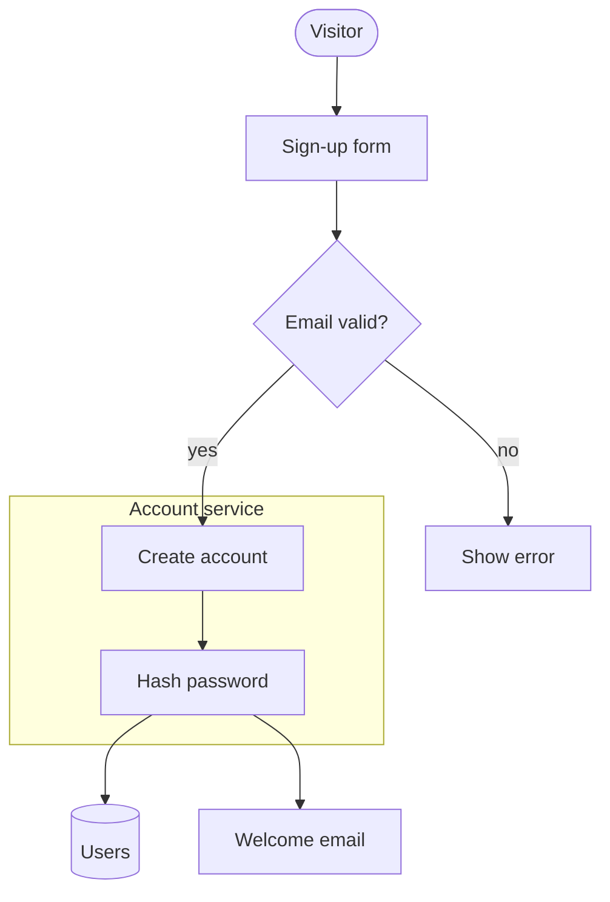

# Integrations

This page holds how to use flowfig with a coding agent, React, Node, an MCP client and Mermaid.

## Use with your coding agent

`npx flowfig init` writes flowfig instructions for the coding agents of a repo. The instructions tell the agent how to write a
spec, check the spec, and render the SVG.

```bash
npx flowfig init            # the current directory
npx flowfig init path/to/repo
```

On a terminal, `init` shows a picker. The picker selects the agents that the repo already uses. If it finds none, it selects
`AGENTS.md`. Type the numbers to toggle agents, press Enter to write, or type `q` to quit.

| Id         | Agent          | File                              | How                                  |
| ---------- | -------------- | --------------------------------- | ------------------------------------ |
| `claude`   | Claude Code    | `.claude/skills/figure/SKILL.md`  | whole file (a skill)                 |
| `agents`   | AGENTS.md      | `AGENTS.md`                       | section (for Codex, Amp, Jules, ...) |
| `cursor`   | Cursor         | `.cursor/rules/flowfig.mdc`       | whole file                           |
| `copilot`  | GitHub Copilot | `.github/copilot-instructions.md` | section                              |
| `gemini`   | Gemini CLI     | `GEMINI.md`                       | section                              |
| `windsurf` | Windsurf       | `.windsurf/rules/flowfig.md`      | whole file                           |
| `kiro`     | Kiro           | `.kiro/steering/flowfig.md`       | whole file                           |

| Flag             | Effect                                                        |
| ---------------- | ------------------------------------------------------------- |
| `--agents <ids>` | Write for these agents, for example `--agents claude,cursor`. |
| `--all-agents`   | Write for all 7 agents.                                       |
| `-y`, `--yes`    | Write for the agents that the repo uses, with no picker.      |
| `--global`       | Write the Claude skill and the MCP entry to your home folder. |
| `--dry-run`      | Print what `init` would write, and write nothing.             |
| `--no-mcp`       | Do not register the MCP server.                               |
| `--list-agents`  | Print the agent ids.                                          |

With no terminal and no `-y`, `--agents` or `--all-agents`, `init` prints the agent ids and exits with code 2.

A section sits between `<!-- flowfig:start -->` and `<!-- flowfig:end -->`. A second run replaces that section and keeps the rest
of the file. A second run also replaces a whole file that `init` wrote. If a whole file exists and did not come from `init`,
`init` skips the file. `init` also skips a section file that has a start marker and no end marker.

`npx flowfig docs` prints the core guide as Markdown. `npx flowfig docs <topic>` prints one topic: `lanes`, `timeline`, `rail`,
`marks` or `verify`.

## Use in React

```tsx
import { Flow, type FlowProps } from 'flowfig';
import spec from './first.json';

export const LoadUser = () => <Flow {...(spec as FlowProps)} />;
```

The player has these controls:

- One tab for each step, with a progress line. A click on a tab starts that step.
- A pause button, and a speed button that changes between 1× and 2×.
- A full screen button. Esc closes full screen.
- The step tabs take the Left, Right, Home and End keys.
- A hover on a box highlights its edges. With the rail, a click on a row starts that message, and a hover highlights its edge.
- A hover on a box, an edge or a rail row with a `source` shows the `source`. The SVG shows it as a tooltip too.

The player props are the spec fields. `theme` sets the colors, `speed` sets the packet time, and `autoplay={false}` stops the
auto start. `check` runs the check rules. If a figure is wider than its container, the player changes the figure to fit.
In a box under 600 px, the player keeps reader text at 11 px or more. If the map does not fit, the player draws the map as a column.
In a box of 600 px or more, the player folds the map only when text would fall under 9 px.
A lanes map or a timeline map stops at that size and scrolls sideways in its pane. If the reader asks for reduced motion, the player shows the last beat and does not move packets.

The player has no dark theme of its own. For dark mode, set the `--fig-*` CSS variables on `.flowfig`:

```css
@media (prefers-color-scheme: dark) {
  .flowfig {
    --fig-accent: #1f78c8;
    --fig-fg: #e3e3e3;
    --fig-muted: #9aa0a6;
    --fig-bg: #1b1b1d;
    --fig-surface: #242526;
    --fig-border: #3a3b3c;
  }
}
```

These are the built-in dark colors. `flowfig` exports them as `DARK`, and the light colors as `LIGHT`.

## Use from Node

`flowfig/svg` needs no React and no browser.

```ts
import { readFileSync, writeFileSync } from 'node:fs';
import { check, toSvg } from 'flowfig/svg';

const spec = JSON.parse(readFileSync('first.json', 'utf8'));
for (const f of check(spec)) console.log(f.severity, f.rule, f.message);
writeFileSync('first.svg', toSvg(spec));
```

- `toSvg(spec, options)` returns the SVG string. The options are `speed`, `padding` (default 24) and `theme`.
- `check(spec, options)` returns the findings. It also takes `width` and `minText`.
- `render(spec, options)` returns `{ svg, scene }`. The scene is the layout that the check reads. Its shape can change.

`flowfig/verify` is for Node only. It exports `verify`, `verifyReport` (the findings and the counts), `links`, `owners` and `parseSource`, the same checks
as `flowfig verify`.

`toSvg` does not put the spec in the SVG. Only the CLI adds the spec, which `--spec` reads back.

## MCP server

`npx flowfig mcp` serves the tools `docs`, `check`, `render`, `verify` and `diff` over stdio, for an agent with no shell.
`render` writes the SVG file and returns the check lines and the path, so no SVG text goes through the model. `docs` takes an
optional `topic`.

`npx flowfig init` registers the server for Claude Code (`.mcp.json`), Cursor (`.cursor/mcp.json`), GitHub Copilot
(`.vscode/mcp.json`), Gemini CLI (`.gemini/settings.json`) and Kiro (`.kiro/settings/mcp.json`). It merges one entry into
the file and keeps every other server. `--no-mcp` skips this step. If you formatted the file with other spacing, the first
run rewrites it once. For any other client, add:

```json
{ "mcpServers": { "flowfig": { "command": "npx", "args": ["flowfig", "mcp"] } } }
```

## Convert Mermaid

`flowfig from-mermaid` turns a Mermaid flowchart, sequence diagram, state diagram or `gantt` into a flowfig spec. The converter uses no model.
Then `check` and `verify` can test the figure.

```console
$ cat login.mmd
sequenceDiagram
    participant W as Web app
    W->>A: POST /login
    A-->>W: 200 session cookie
    A-)Q: user.logged_in
$ npx flowfig from-mermaid login.mmd > login.json
$ npx flowfig login.json login.svg
```

The input is a `.mmd` file with one diagram, or a Markdown file. In a Markdown file, each fenced block with the language
`mermaid` is one diagram. `-` reads one diagram from stdin. With one diagram, the command prints the spec. With
`--out <dir>`, the command writes one JSON file for each diagram, such as `docs-1.json` and `docs-2.json`.

The command exits 1 if a diagram has a line that the converter does not read. It prints `<file>:<line>: <reason>` for each
line, and writes no spec for that diagram. The command never guesses.

This flowchart has a decision, a subgraph and a store:



`npx flowfig from-mermaid signup.mmd > signup.json` converts it. `npx flowfig signup.json docs/from-mermaid.svg` renders it:


A flowchart (`flowchart` or `graph`) becomes a still map with automatic layout:

- Nodes: `A`, `A[text]`, `A(text)`, `A([text])`, `A((text))`, `A{text}` (a decision) and `A[(text)]` (a store). The text can
  have quotes. `<br>` becomes a space. `#quot;`, `#amp;`, `#lt;`, `#gt;`, `#apos;`, `#nbsp;` and `#NN;` (a decimal code)
  become their characters.
- Links: `-->`, `-.->`, `==>`, with a label as `-->|text|` or `-- text -->`. Chains (`A --> B --> C`) and `&`
  (`A & B --> C`) are read.
- `subgraph id`, `subgraph id [title]`, `subgraph id["title"]` or `subgraph title` ... `end` becomes a group with a frame. A subgraph with no
  node is dropped.
- `classDef`, `class`, `style`, `linkStyle`, `click`, `direction`, `:::class` and `%%` comments are ignored.
- In all four diagram types, `accTitle:`, `accDescr:` and `accDescr { ... }` are ignored.

A sequence diagram becomes a rail (`rail: "only"`):

- Each `participant` or `actor` is a box. A participant that first shows in a message is a box too.
- Each pair of participants gets one edge. Each message is one hop on that edge, with its text in `data`.
- A message in the other direction of the edge is a hop with `back: true`. `-)` gives `async: true`.
- With no `alt`, the figure has one step with all the messages.
- Each `alt` or `else` branch becomes one step. The step has the messages before the `alt`, the messages of that branch, and
  the messages after the `end`. The step label is the branch condition.
- `loop`, `opt`, `par`, `and` and `rect` lines are ignored. Their messages stay in order in each step.
- `activate`, `deactivate`, `+` and `-`, `Note` and `autonumber` are ignored.

A state diagram (`stateDiagram` or `stateDiagram-v2`) becomes a still map with automatic layout:

- Each state is a box. `state "Long name" as A` sets the label. `A : text` puts the text under the label, as Mermaid does.
- `A --> B` and `A --> B : text` become an edge with a label.
- `[*] --> A` at the top level gives A `mark: "start"`. `A --> [*]` at the top level gives A `mark: "end"`.
- `state A { ... }` becomes a group with a frame. A `[*]` in it gives no edge and no mark.
- `state A <<choice>>` becomes a decision. Its label is its id.
- `direction`, `classDef`, `class`, `%%` comments, `note` and `hide empty description` are ignored.

A `gantt` becomes a timeline (`timeline: true`):

- Each `section` is a track. Each task is a box in its track. A task with no id gets the id `task-1`, `task-2` and so on.
- A task can have a start date or `after <id>`, and an end date or a duration in days (`10d`) or weeks (`2w`).
  A task with only a duration starts when the task above it ends.
- Mermaid reads an end date as the start of that day. So the box `to` is the day before the end date.
- `after a b` starts the task when the last of `a` and `b` ends. Each id gives an edge to the task.
- `milestone` with `0d` gives a box with only `from`. `crit` gives `tone: "red"`. `done` and `active` are ignored.
- `title`, `axisFormat`, `tickInterval`, `todayMarker`, `weekday` and `click` are ignored. The today line uses the flowfig default.

Limits:

- `RL` reads as `LR`, and `BT` reads as `TB`. The automatic layout sets the order of the boxes.
- `-.->` and `==>` give a plain edge. flowfig has no dotted or thick edge.
- A link with no arrow (`---`, `-.-`, `===`) is an error. Use `-->` to give it a direction.
- Other node shapes, Markdown strings, `<-->`, `--o`, `--x`, `-x` and a message to the same participant are errors.
- A second `alt` and an `alt` inside an `alt` are errors.
- In a state diagram, `<<fork>>`, `<<join>>`, a concurrent region (`--`), `:::class` and a transition to the same state
  are errors. A `[*]` on a composite state, a description on a composite state and a label on a `[*]` transition are errors too.
- A state with a start and an end transition is an error, because a box has one mark.
- In a `gantt`, a `dateFormat` other than `YYYY-MM-DD`, `excludes`, `weekend`, `inclusiveEndDates`, `until`, a duration in
  hours and a milestone with a duration are errors. These change the dates, and the converter never guesses a date.
