# The spec

This page holds the figure format, how to read and change a figure, and the limits of flowfig.

## Your first figure

Save this spec as `first.json`. The spec has 3 boxes, 2 edges and 1 step.

```json
{
  "layout": {
    "children": [
      { "id": "browser", "label": "Browser" },
      { "id": "api", "label": "API" },
      { "id": "db", "label": "Database", "shape": "store" }
    ]
  },
  "edges": [
    { "from": "browser", "to": "api", "label": "GET /user" },
    { "from": "api", "to": "db", "label": "read the user" }
  ],
  "steps": [
    {
      "label": "Load a user",
      "flow": [
        { "edges": "browser->api", "say": "The browser asks the API for the user." },
        { "edges": "api->db", "say": "The API reads the row." },
        { "edges": { "edge": "api->db", "back": true }, "say": "The row comes back." },
        { "edges": { "edge": "browser->api", "back": true }, "say": "The API sends the user as JSON." }
      ]
    }
  ]
}
```

Render the spec:

```console
$ npx flowfig first.json
0 errors, 0 warnings
figure: 3 boxes, 0 groups, 2 edges, 1 step, 4 messages
browser -> api: GET /user
api -> db: read the user
step "Load a user": 4 hops
alt: Flow figure: Browser, API, Database. Steps: Load a user.
first.svg — 10.1 kB
```

The render prints the check result, the counts, one line per edge and one line per step. Read these lines to check the figure
without a second command. If a box or an edge has a `source` or a `via`, the render also prints the `verify` counts.
`--no-verify` skips them.

The command writes `first.svg`:


The SVG has no script and fetches no font. GitHub shows the SVG in a README, a PR or an issue. The SVG follows the light or dark
color scheme of the reader.

## Read and change a figure

Each SVG from the CLI carries its own spec. These commands made the rail-only figure from `docs/checkout.svg`:

```bash
npx flowfig --spec docs/checkout.svg > checkout.json   # print the spec in the SVG
# edit checkout.json: set "props.rail" to "only"
npx flowfig checkout.json docs/checkout-rail-only.svg
npx flowfig verify docs/checkout.svg                    # check each source and each edge against the code
npx flowfig diff old.svg docs/checkout.svg              # list what changed in the spec
npx flowfig diff old.svg docs/checkout.svg --svg diff.svg   # draw the change in one figure
```

The diff SVG is a still figure. Green marks an added box or edge, red and dashed marks a removed one, and orange marks a changed one.
The diff SVG has no spec. The Action and `coverage` skip it. `verify` and `--spec` report that it has no spec.

## Forms

To explain a flow one moment at a time in a web page, see [Explain a flow in a web page](explain.md#explain-a-flow-in-a-web-page).

The map (the default) shows the parts and the messages between them:


The map and the rail (`rail: true`) adds one row for each message, with its payload:


The rail only (`rail: "only"`) shows the order of the messages without the map:



Swimlanes (`lanes: true`) give each role a lane and put the steps left to right in time order:


A long swimlane process wraps into blocks at the page width. An edge between two blocks becomes two labeled stubs:



The timeline (`timeline: true`) draws a roadmap with one track per team, dated bars, milestones and a today line:


A state lifecycle marks the first state with `mark: "start"` and each final state with `mark: "end"`:


A box with inside parts opens to show them, down to 3 levels. See [Inside a box](#inside-a-box).

## The spec

A spec has a `layout`, `edges`, and optional `steps`. The full types have doc comments, so your editor shows each field. For the
full reference, run `npx flowfig docs`.

### Boxes

| Field    | Meaning                                                                                                   | Default                             |
| -------- | --------------------------------------------------------------------------------------------------------- | ----------------------------------- |
| `id`     | The name that edges and steps use. It must be unique.                                                     | required                            |
| `label`  | The title in the box.                                                                                     | required                            |
| `sub`    | A smaller line under the label.                                                                           | none                                |
| `shape`  | `"box"`, `"decision"` (a diamond) or `"store"` (a data cylinder).                                         | `"box"`                             |
| `check`  | The question on the gate in the guide world. The labels of the edges out of the box are the answers.      | the label, for a `decision` box     |
| `done`   | The state after the box, such as "Cake baked". The ending tags of the guide world show it.                | the label                           |
| `source` | The code this draws: `path` or `path#symbol`. `flowfig verify` checks it.                                 | none                                |
| `detail` | A more detailed figure: the SVG path from the repo root. `flowfig atlas` links the box to it.             | none                                |
| `lines`  | The least number of text lines that a content card keeps.                                                 | none                                |
| `width`  | The width in px. This value replaces the width that layout picks.                                         | from layout                         |
| `at`     | In a `lanes` figure: the time column of the box, from 0.                                                  | the order of first use in the steps |
| `from`   | In a `timeline` figure: the start date of the item, as YYYY-MM-DD. A box with only `from` is a milestone. | none                                |
| `to`     | In a `timeline` figure: the last day of the item, as YYYY-MM-DD.                                          | none                                |
| `mark`   | `"start"` draws a dot before the box. `"end"` draws a ring after the box. Use it on a state lifecycle.    | none                                |
| `look`   | One of the 12 pictures that the guide world draws for this box.                                           | none                                |

### Groups

`layout` is a group. A group holds boxes and other groups.

| Field       | Meaning                                                                                                  | Default                                             |
| ----------- | -------------------------------------------------------------------------------------------------------- | --------------------------------------------------- |
| `children`  | The boxes and groups in the group, in order.                                                             | required                                            |
| `id`        | The name that an edge can use to reach the whole group.                                                  | none                                                |
| `label`     | The title of the frame. Only a group with a label has a frame.                                           | none                                                |
| `direction` | `"row"` puts the children side by side. `"column"` stacks them.                                          | `"row"`                                             |
| `gap`       | The smallest space between the children in px. It grows to fit the labels of edges that cross the group. | column: 28; row: fits the widest label, at least 56 |
| `align`     | `"start"`, `"center"` or `"end"`, across the direction.                                                  | `"center"` (a column stretches)                     |
| `auto`      | On the root layout: `true` makes flowfig place the boxes. See [Automatic layout](#automatic-layout).     | off                                                 |
| `look`      | One of the 12 pictures that the guide world draws for this group.                                        | none                                                |

### Automatic layout

Set `"auto": true` on the root layout and list the boxes. flowfig places them in ranks, in the direction of the edges.
Use it when you do not want to plan rows and columns, or when `check` reports an edge through a box.

```json
{
  "layout": {
    "auto": true,
    "children": [
      { "id": "api", "label": "API" },
      { "id": "queue", "label": "Queue", "shape": "store" },
      { "label": "Workers", "children": [{ "id": "w", "label": "Worker" }] }
    ]
  },
  "edges": [
    { "from": "api", "to": "queue", "label": "enqueue" },
    { "from": "queue", "to": "w", "label": "pull" }
  ]
}
```

Render the spec with `npx flowfig spec.json docs/auto-layout.svg`. This figure has 9 boxes, 1 frame, 1 decision, 1 store and 2 steps:


A group with a `label` or an `id` stays together as one frame. flowfig removes a group with neither, with its `direction`, `gap`
and `align`. flowfig ignores `around` on the edges. A `direction` on the root forces `"row"` or `"column"`. `lanes` and
`timeline` figures ignore `auto`.

### Inside a box

A box can hold its inside parts, down to 3 levels. Put the parts in `inside`, with the same fields as a figure:
`layout`, `edges` and `steps`. An inside edge can start or end at an outer neighbor of the box. The open box shows that
neighbor as a port.

```json
{
  "id": "orders",
  "label": "Orders",
  "source": "src/orders.ts#createOrder",
  "inside": {
    "layout": {
      "auto": true,
      "children": [
        { "id": "validate", "label": "Check the cart", "source": "src/orders.ts#validateCart" },
        { "id": "save", "label": "Save the order", "source": "src/orders.ts#insertOrder" }
      ]
    },
    "edges": [
      { "from": "gateway", "to": "validate" },
      { "from": "validate", "to": "save" },
      { "from": "save", "to": "payments" }
    ]
  }
}
```

The SVG plays a tour: it opens each box in turn and plays one step inside it. A README image shows that tour. Add
`--script` to open a box with a click when the SVG is in a browser tab. `--scene orders` renders one level as a plain
figure. The React player opens a box on a click. `check` and `verify` run on each level.


### Edges

| Field     | Meaning                                                                                                                                                                                                                            | Default    |
| --------- | ---------------------------------------------------------------------------------------------------------------------------------------------------------------------------------------------------------------------------------- | ---------- |
| `from`    | The id of the box or group where the edge starts.                                                                                                                                                                                  | required   |
| `to`      | The id of the box or group where the edge ends.                                                                                                                                                                                    | required   |
| `id`      | The name that beats use.                                                                                                                                                                                                           | `from->to` |
| `label`   | The text on the edge.                                                                                                                                                                                                              | none       |
| `around`  | `"above"`, `"below"`, `"left"` or `"right"` routes the edge around the boxes between, on that side.                                                                                                                                | none       |
| `quiet`   | `true` draws the edge only while a step uses it.                                                                                                                                                                                   | `false`    |
| `carries` | What moves on the edge in the guide world: `"data"`, or `{ thing, form, count, from }` for a physical thing. `form` is `box`, `barrel` or `notes`. `count` is 1 to 4. `from` is the id of the box or group where the thing starts. | `"data"`   |
| `source`  | The code this edge draws: `path` or `path#symbol`. `flowfig verify` checks it.                                                                                                                                                     | none       |

### Steps

Each step is one story. The player shows one tab for each step. With no steps, the figure is a still map.

| Field     | Meaning                                                                                                | Default                         |
| --------- | ------------------------------------------------------------------------------------------------------ | ------------------------------- |
| `label`   | The tab title.                                                                                         | required                        |
| `flow`    | The beats, in play order.                                                                              | required                        |
| `caption` | The line under the figure while no beat has a `say`.                                                   | none                            |
| `outcome` | One sentence, 15 words or fewer, about how the story ends. The guide shows it at the end of the story. | "Ends at: <the last box label>" |
| `nodes`   | The ids of the boxes to highlight for the whole step.                                                  | none                            |

### Beats

A beat is an edge id, an array of edge ids that run at the same time, or an object:

| Field   | Meaning                                                                                    | Default        |
| ------- | ------------------------------------------------------------------------------------------ | -------------- |
| `edges` | One hop or an array of hops. A hop is an edge id or `{ edge, back, data, async, source }`. | none (a pause) |
| `say`   | The line of narration for the beat.                                                        | none           |
| `show`  | `{ boxId: content }` fills the content card of a box until the step ends.                  | none           |
| `light` | The ids of the boxes to highlight for this beat only.                                      | none           |
| `note`  | The reason for the beat, in one line. The guide form shows it under the `say` line.        | none           |
| `ms`    | The length of the beat in ms.                                                              | `speed` (900)  |

In a hop, `back: true` runs the packet from `to` to `from`. `data` is a small card on the packet. `async: true` marks a message
that does not wait for an answer. On the rail, an `async` hop has a dashed arrow and an `async` tag. The hops of one beat
share a parallel band on the rail.

Content is an array of rows, or a React node in the player. A row is `{ text, tag, tone, meta, mark, mono }`. Only `text` is
required. The tones are `blue` (the default), `purple`, `green`, `orange` and `gray`.

### Figure options

| Field      | Meaning                                                                              | Default  |
| ---------- | ------------------------------------------------------------------------------------ | -------- |
| `rail`     | `true` draws the rail under the map. `"only"` draws the rail alone.                  | `false`  |
| `lanes`    | `true` draws swimlanes: a `column` group of labeled groups, one lane per role.       | off      |
| `timeline` | `true` draws a timeline: one labeled group per track, with the boxes at their dates. | off      |
| `today`    | In a `timeline` figure: the date of the today line, as YYYY-MM-DD.                   | none     |
| `speed`    | The time in ms for a packet to cross one edge.                                       | 900      |
| `theme`    | `{ accent, fg, muted, bg, surface, border, font }`. Each key is optional.            | built-in |
| `autoplay` | Start to play when the figure mounts. Only the React player reads it.                | `true`   |
| `check`    | Run the check rules in the browser. Only the React player reads it.                  | `false`  |

A figure is as wide as its boxes need, and at least 320 px. The step captions wrap at the figure
width, so a narrow figure fits a phone screen at full size. A rail-only figure is at least 560 px.

## What flowfig does not draw

flowfig draws parts, the messages between the parts, and their order. flowfig draws a roadmap or a timeline with dates (`timeline: true`),
and converts a Mermaid `gantt` to it. flowfig does not draw class diagrams, ER diagrams, charts of numbers or mind maps. Use Mermaid
or a chart library for those.
